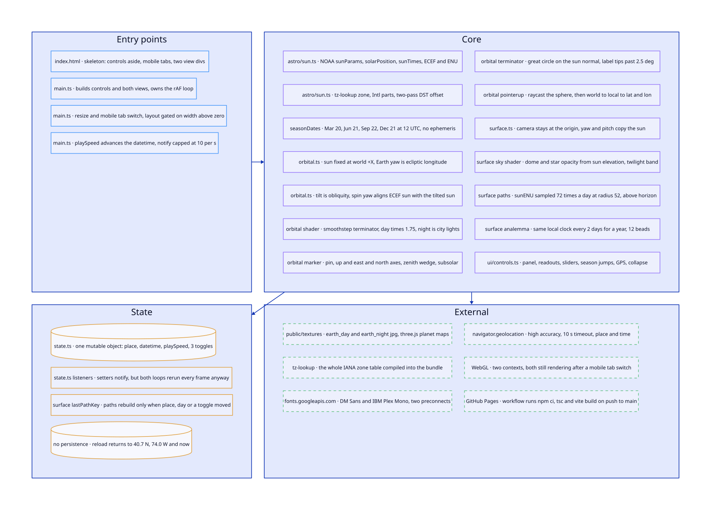

# sun_visual

A browser toy that shows where the sun is — twice: once on a tilted globe, once in your own sky — driven by a single place and a single clock.

## Read it left to right

- **One mutable object is the whole model.** `state.ts` holds lat, lon, datetime, play speed and three view toggles. Nothing is persisted: no URL state, no `localStorage`, so every reload returns to 40.7°N / 74.0°W and "now". The listener set barely matters — `main.ts` renders both views on every animation frame, and each `render()` recomputes exactly the values `notify()` would.
- **Time is an instant, never a wall clock.** `state.datetime` is UTC. Local time is derived on demand: `tz-lookup` names the IANA zone, `Intl.DateTimeFormat.formatToParts` reads the civil fields back out, and `fromLocalParts` samples the DST offset twice so that setting 02:30 on a spring-forward day lands somewhere real.
- **The orbit view is a rig, not a simulation.** The sun is pinned at world +X, 48 units out, so its rays read as parallel; the Earth turns beneath it. Yaw comes from the sun's ecliptic longitude, tilt from the obliquity, and the spin angle is whatever aligns the true subsolar point with the tilted sun — season, day and hour all fall out of that one rotation. The terminator is rebuilt every frame as a great circle on the sun normal, and its label flips to "tipped" only past 2.5° of declination.
- **The sky view never moves the camera.** It sits at the origin and just turns toward the sun; sky colour, star fade, today's arc, the three season arcs and the analemma are all sampled from `sunENU` at a fixed radius of 52. It is an illustration of the maths, not a physical sky.
- **Two WebGL contexts stay alive.** The mobile tabs only toggle a CSS class — both the hidden and the visible view keep rendering every frame, and `dispose()` exists on both views but is never called. `seasonDates` is four hardcoded dates at 12:00 UTC, so the equinox/solstice buttons land on approximately the right day, as the README's "NOAA-style approximations" admits.

---

Diagram source: [`docs/system.d2`](docs/system.d2) · rendered by [`scripts/render-diagram.sh`](scripts/render-diagram.sh) into `docs/system.svg` (light + dark) and `docs/system.png` (dark, for gpm desktop).
